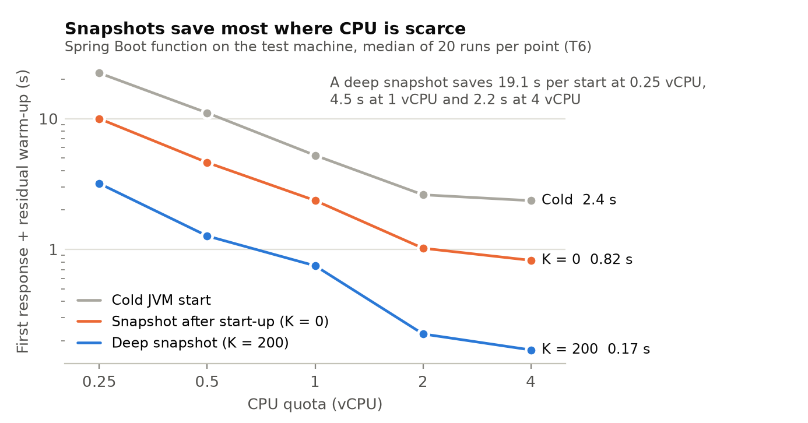

# Decision memo: is CRIU the right mechanism, and where is the optimisation?

**MSc thesis, Amirkabir University of Technology** · 8 October 2026 · measured on the test machine
(8 × Xeon Gold 6248R, Ubuntu 24.04, CRIU 4.2.1, Zulu CRaC JDK 21) and in the workflow simulator

> **Engine note.** The Zulu CRaC JDK checkpoints with Azul's *Warp* engine by default, not CRIU.
> D1, T1b and T3–T6b ran with Warp; D2 measured both engines on the same function. Where this memo
> says "snapshot restore" it means CRaC; the CRIU numbers are given wherever they were measured.

*Two doubts were raised: (1) is snapshotting with CRIU a wise choice at all, and (2) does the
approach contain a real optimisation, or is it "restore earlier"? This memo answers both with
measurements taken for this purpose. Every number links to its raw data and report.*

---

## 1. Is snapshotting (CRaC, with CRIU or Warp) worth it? Yes, by a wide margin

**The competitor that needs no CRIU.** JDK 24/25 ship an ahead-of-time cache (Project Leyden,
JEPs 483/514/515): a training run records loaded and linked classes and method profiles, and later
starts reuse them. It runs in plain Docker, needs no special privileges and cannot clone secrets.
If it came close to a snapshot restore, CRIU would not be worth its operational cost.

**Test D1** (`results/box/D1-aot-vs-crac/REPORT.md`): the same Spring Boot function, seven start
modes, CPU quota 0.25 and 1 vCPU, n = 20 per cell, random order. Time from launch to the first
response, median:

| start mode | 0.25 vCPU | 1 vCPU | CPU-s per start |
|---|---|---|---|
| cold start (JDK 21 / JDK 25) | 16.9 / 17.6 s | 3.97 / 4.08 s | 5.4–5.7 |
| JIT capped at C1 (`TieredStopAtLevel=1`) | 9.8 s | 2.32 s | 3.0 |
| JDK 25 AOT cache, trained with 50 requests | 8.7 s | 2.05 s | 3.0–3.3 |
| CRaC restore (Warp), checkpoint after start-up (SnapStart's point) | 2.09 s | 0.50 s | 2.0 |
| **CRaC restore (Warp), checkpoint after 50 requests** | **0.29 s** | **0.08 s** | **1.2** |
| **same with the CRIU engine** (D2) | **0.38 s** | **0.08 s** | **1.0** |

- The AOT cache halves a cold start (0.55×), but **a depth-50 snapshot answers 25–30× sooner**
  (95% CI lower bounds 23× and 29×) and uses 2.5× less CPU per start. Registered decision rule:
  ≥ 3× at both CPU levels → snapshots are justified. They are, with either engine: **CRIU is only
  17–91 ms slower than Warp** (D2, `results/box/D2-warp-vs-criu/REPORT.md`), so the AOT cache is
  still 23–24× slower to first response than a CRIU restore.
- One prediction failed: after a deep restore, the residual JIT warm-up over the next 200 requests
  is *not* smaller than the AOT cache's. The snapshot's advantage is the first response.

**Do parallel restores serialise?** (T1b, `results/box/T1b-crac-docker/REPORT.md`, n = 20, ≈2,400
restores, 0 failures). Through `docker run`, 4 restores at once are slowed by β = 0.21 (0.25 vCPU)
to 0.53 (1 vCPU), but a control that starts empty containers shows **all of it is Docker creating
containers** (~250 ms each, serialised). Restoring into containers that already exist (OpenWhisk's
prewarmed "stem cells") gives **β = 0.04–0.07 at N = 4** and a restore of **100 ms at 1 vCPU**
(vs 419 ms through `docker run`). Design consequence: restore into stem containers.

**Safety** (T5, `results/box/T5-uniq/REPORT.md`): copies restored from one image repeat the
start-up `Random`, any secret generated at start-up, and `Math.random()` (1 distinct value in 10
copies). A CRaC reset hook fixes the first two (10/10), **not `Math.random()`**, which has no
re-seed API. The snapshot builder must refuse, or reset by reflection, functions that call it
before the checkpoint. This is a concrete instance of the review's point that not every function
is safe to snapshot.

## 2. Where is the optimisation? Fewer cores for the same latency

The review said report 1 only "restores earlier" (Xanadu's idea applied to snapshots). Report 2
added the CPU plan: start-up CPU allocated along the workflow from deadlines (max-flow optimum,
online rule). Its weakness was that on the Azure trace with a 32–64-core server it gained nothing
over an equal split, because spare CPU was never short.

**Reframed as cost** (simulator e12, Azure 2021 trace, 3 days, 433,000 calls, functions at
0.25 vCPU, 5 seeds; `ideas/sim/results/e12_summary.txt`): the question is not "faster on an
oversized server" but **"how small a server holds the same latency"**.

| node | equal split (cold workflows, mean / p99) | **CPU plan** | all calls p99 (equal / plan) |
|---|---|---|---|
| 20 cores | 1.06 / 2.64 s | **0.89 / 2.12 s** | 2.47 / 2.41 s |
| 24 cores | 0.96 / 2.20 s | **0.86 / 1.79 s** | 2.40 / 2.34 s |
| 32 cores | 0.87 / 1.53 s | 0.84 / 1.55 s | 2.29 / 2.29 s |

- On 20–24 cores the plan is better on every metric in all 5 seeds (cold workflows −11 to −16%
  mean, −18 to −20% p99; all calls −2 to −3% p99). **It reaches on 20 cores the cold-workflow mean
  the equal split needs 32 cores for: ≈ 37% fewer cores.**
- Against the industrial baseline (Cloud Run-style boost with on-demand restore), cold-workflow
  p99 never falls below 6.2 s at any node size from 12 to 48 cores (seed 1); with look-ahead and
  the plan it is 2.1 s on 20 cores.
- Limits, reported as found: at 16 cores every policy is unstable (the equal split's all-calls p99
  ranges 2.7–12.6 s across seeds). Two "fixes" were tried and rejected: a guaranteed quota for
  start-ups (worse) and an equal split under overload (safe, but keeps a third of the gain).

**The optimisation problem the thesis now states:** for each stage of a workflow, choose its start
mode (warm, snapshot restore at depth K, AOT-cached or C1 cold start), when it starts, and how much
CPU it gets while starting, to meet latency targets on the fewest cores under a memory budget.
Its parts are classical (critical path, max-flow scheduling, multiple-choice knapsack for depth)
and cited as such; the model, the measurements that set its parameters, and the result that it
saves cores are ours.

## 3. The CPU plan's premise, measured (T6b, T3, T4, T6; 1,280 runs, 0 failures)

- **Start-up is CPU work that speeds up with CPU at constant CPU-seconds** (`results/box/T6b-speedup`).
  A cold JVM start: 16.6 / 8.0 / 4.0 / 2.0 / 1.8 s at 0.25 / 0.5 / 1 / 2 / 4 vCPU — 4.2× faster at 4×
  the CPU, 8.3× at 8×, always ≈ 5.2 CPU-s. A restore at K = 0: 3.5× from 0.25 to 1 vCPU. **So the plan
  has something to allocate.** The model capped a start-up at one core; it uses about **two**.
- **Boosting only while starting works, with a caveat:** lowering the quota after the first response
  takes effect in 1.4–4.8 ms and costs no extra CPU, but for cold starts and shallow snapshots the
  remaining warm-up then moves into the following requests (17–52% slower). The boost should last
  until warm-up is done, not until the first response.
- **On one spare core, one start-up at a time beats an equal split** by 19–27% in mean ready time
  (the plan's rule for ≤ 1 spare core).
- **Snapshots save most where CPU is scarce:** 19.1 s per start at 0.25 vCPU vs 2.2 s at 4 vCPU (T6).
  The relative cliff does *not* flatten with depth (it steepens), a falsified prediction.
- **Profile, measured:** image 82–88 MB at every depth; deep restore ≈ 60–84 ms at 1–4 vCPU
  (the thesis assumed 650 ms); residual warm-up keeps falling to K = 200 (no plateau, so
  Proposition 8's stopping rule does not trigger); checkpoint loss L(50) = 955 ms at 0.25 vCPU,
  and re-warming while waiting recovers more than all of it (keep re-warm).
- **Open:** deep restores interleaved with cold JVM runs were bimodal (≈ 70 or ≈ 300 ms at 1 vCPU);
  cause unknown, not eviction or disk.

## 3b. Reading figure 9: what snapshot depth and CPU do together

**What K is.** K is the snapshot's *depth*: how many warm-up requests the function served before
the checkpoint. **K = 0** checkpoints right after the application has started (framework loaded,
no request served): the point AWS Lambda SnapStart uses; a restore skips start-up, but the JIT has
compiled almost nothing. **K = 200** first serves 200 requests from a fixed test set, so the JIT
compiles the hot code, and only then checkpoints; a restore resumes an already mostly warm process.

**What is plotted.** Time to first response plus the residual warm-up over the next 200 requests:
the whole extra cost a new sandbox pays. Both axes logarithmic. Spring Boot function, median of 20
runs per point, Warp engine (`results/box/T6-cliff`).

| | 0.25 vCPU | 1 vCPU | 4 vCPU |
|---|---|---|---|
| cold start | 22.3 s | 5.2 s | 2.4 s |
| snapshot, K = 0 | 10.0 s | 2.4 s | 0.82 s |
| snapshot, K = 200 | 3.2 s | 0.75 s | 0.17 s |

1. **Start-up is CPU-bound.** Every line falls as the quota rises, about 8–10× from 0.25 to 2 vCPU,
   then flattens: a starting JVM uses about two cores. This is the CPU plan's key assumption,
   measured.
2. **Depth matters as much as having a snapshot.** At 1 vCPU, SnapStart's K = 0 halves the cost
   (5.2 → 2.4 s); K = 200 cuts it another 3× (→ 0.75 s).
3. **Snapshots save most where CPU is scarce:** 19.1 s per start at 0.25 vCPU against 2.2 s at
   4 vCPU. Serverless functions usually get small shares (a 512 MB Lambda ≈ 0.3 vCPU).
4. **A deep snapshot does not make low CPU harmless.** As a ratio the deep-snapshot line falls *more*
   steeply (19× from 4 to 0.25 vCPU, cold 9.4×): what remains after a deep restore is JIT work, and
   it still slows down with less CPU. (The prediction that depth flattens the cliff was falsified.)
5. **The two levers multiply.** A deep snapshot given 2 vCPU while it starts costs 0.22 s, against
   22 s for a cold start at 0.25 vCPU (≈ 100×). Neither depth nor start-up CPU alone gets there;
   choosing both is what the CPU plan optimises.

*Caveats:* one function (Spring Boot), Warp engine; the restore points at 0.25 and 1 vCPU include an
unexplained slow mode and are upper bounds.

## 3c. Is this only Java?

The figure and every box test are Java: CRaC (and its Warp engine) checkpoint only the JVM. The
earlier factor study (exp8, 7 workloads × 5 CPU levels × 20 runs; **run on the laptop, not yet
repeated on the test machine**, whose JVM figures were later revised down) shows the effect depends
on how much compilation a runtime does while starting, not on the language as such:

| runtime class | warm-up after start (1 vCPU) | 4 → 0.25 vCPU | what a snapshot should capture |
|---|---|---|---|
| **JVM** (HotSpot, heavy JIT, big frameworks) | 0.2–0.6 s (laptop); 1.27 s for the Spring Boot function on the test machine | large: 10× (T6) to 13–35× (exp14) on the test machine | **deep: ~50–200 requests** (figure 9) |
| **.NET** (tiered JIT, light) | ≈ 18 ms | 5.4× (≈ 96 ms at 0.25) | one request is enough |
| **Node.js** (V8) | ≈ 3 ms | none measured | start-up only (module loading); the JIT part is noise |
| **Python** (CPython, no JIT) | 0 | start-up (imports) 3.3× slower: 821 vs 248 ms for numpy + pandas | **start-up only (K = 0)** |
| **Go** (compiled ahead of time) | 0 | nothing to warm up | nothing to snapshot |

What carries over: **the method** (measure the warm-up curve, choose the depth per runtime, plan the
start-up CPU along the workflow) and **the CPU effect on start-up**, which also hits Python's import
time. What does not: **deep snapshots pay off only for heavy-JIT runtimes** (the JVM, partly .NET).
For Python and Node the snapshot captures initialisation, so the gain is the start-up time, not
warm-up. **This is also the main argument for CRIU over Warp:** Warp is faster but Java-only; CRIU
checkpoints any process (the test machine's smoke test restored a Python process with its libraries),
so a platform with mixed-language workflows needs it.

*Gap:* no non-Java function has been snapshotted and measured on the test machine yet. The machine
test plan already asks for a Python function and an ML-like Python stage at K = 0 (T3); about an
hour on the next box session.

## 4. Recommendation

Keep CRaC snapshots as the mechanism, with either engine (Warp by default, CRIU within 17–91 ms):
they are 23–30× ahead of the JDK's own alternative, and their restores parallelise once container
creation is taken out of the path. Present the contribution
as the joint start-mode / timing / start-up-CPU plan that serves the same workflows on fewer cores,
with the measured safety limits (`Math.random()`) as an explicit input to which stages may be
snapshotted.
